<!-- ==================== BANNER ==================== -->
<p align="center">
  
</p>

<!-- ==================== INTRO ==================== -->
<div align="center">

  <a href="https://github.com/saumyak0405">
    
  </a>

  <p>
    <a href="https://saumyak0405.github.io">
      
    </a>
    <a href="https://linkedin.com/in/saumyakhubchandani">
      
    </a>
    <a href="mailto:saumyakhubchandani@gmail.com">
      
    </a>
  </p>

</div>

---

<!-- ==================== ABOUT ME ==================== -->
## 👨‍💻 About Me

```java
public final class Saumya {
    String role       = "Backend & Applied AI Engineer";
    String education  = "B.Tech CSE (Information Security), VIT Vellore '27";
    List<String> focus = List.of(
        "Backend systems",
        "LLM agents + eval harnesses",
        "Data pipelines",
        "Computer vision"
    );
    String currently  = "Making agents prove their answers before shipping them";
    String lookingFor = "6-month backend / AI engineering internship";

    boolean isDone(Patch p) {
        return p.passesFullSuite() && p.passesHiddenTests();   // never just its own word
    }
}
```

I like building software that assumes it might be wrong and checks before anyone else has to: agents that re-verify every claim and patch, pipelines that survive a crash without writing a duplicate row, payments that are safe to retry.

`// currently: shipping saas-sync, a Java ELT engine (Stripe + GitHub → Postgres)`

---

<!-- ==================== EXPERIENCE ==================== -->
## 🧭 Where I've Worked

| Role | Where | When |
|---|---|---|
| **AI/ML Engineer Intern** · FastAPI video backend + React dashboard for football tactical analysis; distance error 68% → 3.2% on SoccerNet-GSR | Data Science Technologies Pvt. Ltd. | Jun – Aug 2026 |
| **Quant Development Intern** · 4+ algorithmic strategies on live market data; AngelOne + Zerodha API integrations | AceQuant Research, Mumbai | May – Jul 2025 |
| **Vice Chairperson** · events for 500+ students | IEEE Professional Communication Society, VIT | Mar 2025 – now |

---

<!-- ==================== TECH ARSENAL ==================== -->
## 🛠️ Tech Arsenal

<div align="center">

<b>Languages</b><br/><br/>


<br/><br/>

<b>Backend & Frameworks</b><br/><br/>


<br/><br/>

<b>Data, AI & Tools</b><br/><br/>


</div>

---

<!-- ==================== PROJECTS ==================== -->
## 🚀 Projects

| Project | What it does | Tech Stack |
|---|---|---|
| [mender-agent](https://github.com/saumyak0405/mender-agent) | Coding agent that fixes failing tests without being trusted: policy-gated edits, full-suite re-verification, rollback. Eval harness with injected bugs + hidden tests; **0 false successes** on the committed baseline | `Python` `pytest` `SQLite` `Groq` `Ollama` |
| [finclaim-agent](https://github.com/saumyak0405/finclaim-agent) | Financial research agent that verifies every claim against cited evidence before showing it; prompt-injection quarantine, crash-safe resume | `Python` `yfinance` `SEC EDGAR` `SQLite` |
| [saas-sync](https://github.com/saumyak0405/saas-sync) | Incremental ELT engine: Stripe + GitHub → Postgres with transactional checkpoints, idempotent upserts, rate-limit-aware retries; 61 tests | `Java` `PostgreSQL` `JUnit` `Docker` |
| [Seva](https://seva-iota.vercel.app) | Bilingual marketplace for verified domestic workers; Razorpay with HMAC webhook verification + idempotent refunds; 65 E2E tests | `Next.js` `TypeScript` `PostgreSQL` `Playwright` |

---

<!-- ==================== GITHUB STATS ==================== -->
## 📊 GitHub Stats

<div align="center">


</div>

---

<!-- ==================== LET'S CONNECT ==================== -->
## 🤝 Let's Connect

<div align="center">

<p>Building something that has to be right? I'd like to hear about it.</p>

<p>Always up for <b>backend, data pipeline, or AI agent</b> work. Reach out anytime.</p>

<br/>

<a href="mailto:saumyakhubchandani@gmail.com">
  
</a>
&nbsp;
<a href="https://linkedin.com/in/saumyakhubchandani">
  
</a>

<br/><br/>

<code>while (true) { build(); verify(); ship(); }</code>

</div>
